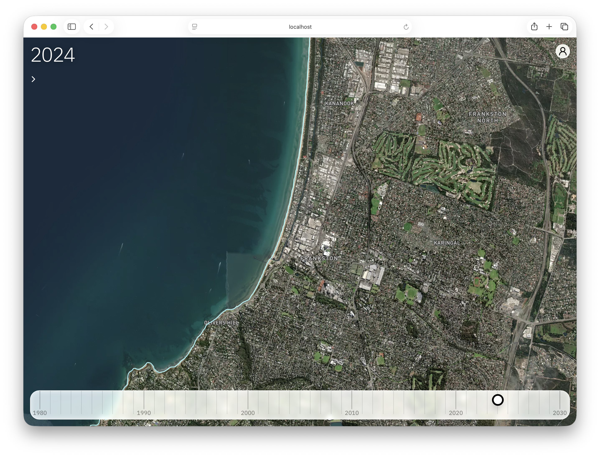
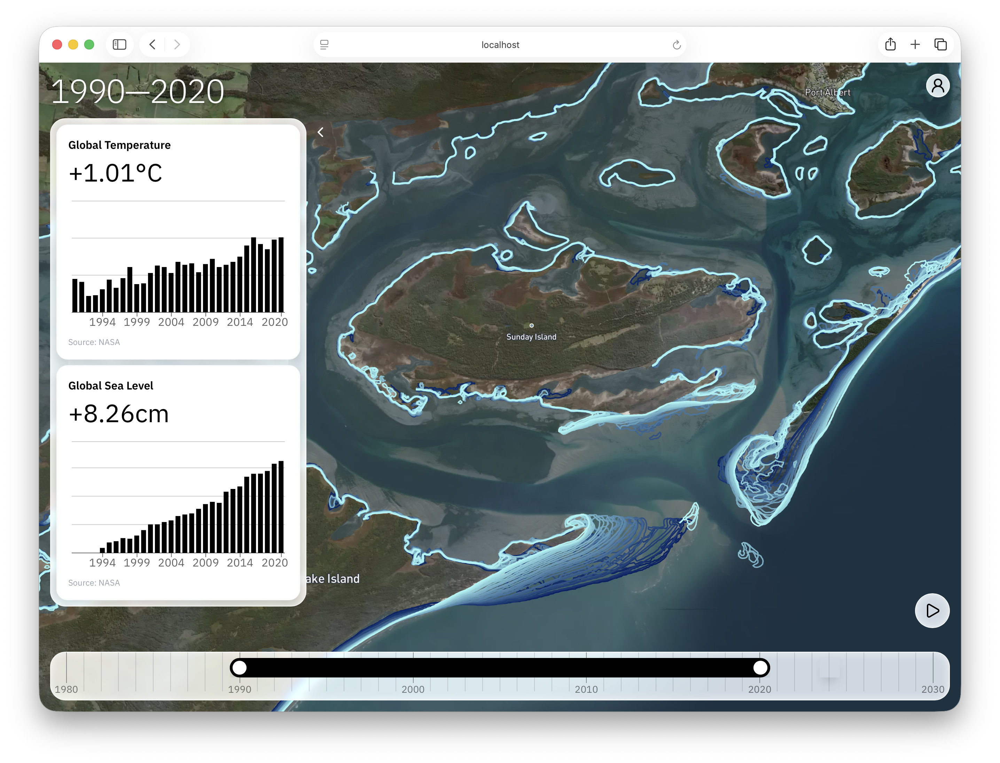

# Coastview

Coastview is a web-based dashboard for visualising coastal movement using aerial imagery and climate data. It enables the assessment of shoreline retreat and their correlation with global climate indicators.



## Features



- Interactive map with visual shoreline overlays.

- Historical shoreline trend analysis using aerial imagery.

- Environmental data integration (temperature and sea-level).

## Architecture

- **Frontend**: Next.js for user interface and dashboard.

- **Backend**: Django REST API for data management and Python functions.

- **Vector Tile Server**: TileServerGL for serving optimised geospatial overlays.

- **Containerisation**: Docker and Docker Compose for deployment.

## Installation

### 1. Clone the repository

```sh
git clone https://github.com/brad99d/coastline-app
```

```sh
cd coastline-app
```

### 2. Create an `.env.local` file

```sh
cp frontend/example.env.local frontend/.env.local 
```

Populate this file with API locations and a Mapbox developer token.

### 3. Supply geospatial coastline data

Acquire the [DEA Coastlines dataset](https://knowledge.dea.ga.gov.au/data/product/dea-coastlines/). This data requires reprojection and conversion for compatibility with Mapbox and TileServer.

Reproject the Australian Albers (EPSG:3577) data to WGS84 (EPSG:4326).

```sh
ogr2ogr -f GeoJSON -s_srs EPSG:3577 -t_srs EPSG:4326 coastline_4326.geojson coastlines_3-0-0.gpkg shorelines_annual -skipfailures
```

Convert the resulting GeoJSON file to an `.mbtiles` format.

```sh
tippecanoe -o coastline.mbtiles --layer=coastline --drop-densest-as-needed coastline_4326.geojson
```

Supply the converted `coastline.mbtiles` file in `tiles/coastline.mbtiles`.

### 4. Supply climate data

Temperature and sea level data is supplied in `.csv` format.

Temperature data example (`backend/data/global_temp.csv`):
```csv
year,temperature,temp_smoothed
1980,0.26,0.20
1981,0.32,0.21
```

Sea level data example (`backend/data/global_sea_level.csv`):
```csv
year,gmsl_cm,gmsl_smoothed_cm
1993,2.135044278125301e-18,-0.010951250000000008
1994,0.4510661346153846,0.45508817307692306
```

### 5. Build the containers

```sh
docker compose up --build
```

### 6. Populate the database

```sh
python manage.py migrate
```

## Acknowledgements

- Coastline data from Geoscience Australia.

- Climate data from NASA.

- Mapping libraries from Mapbox.
